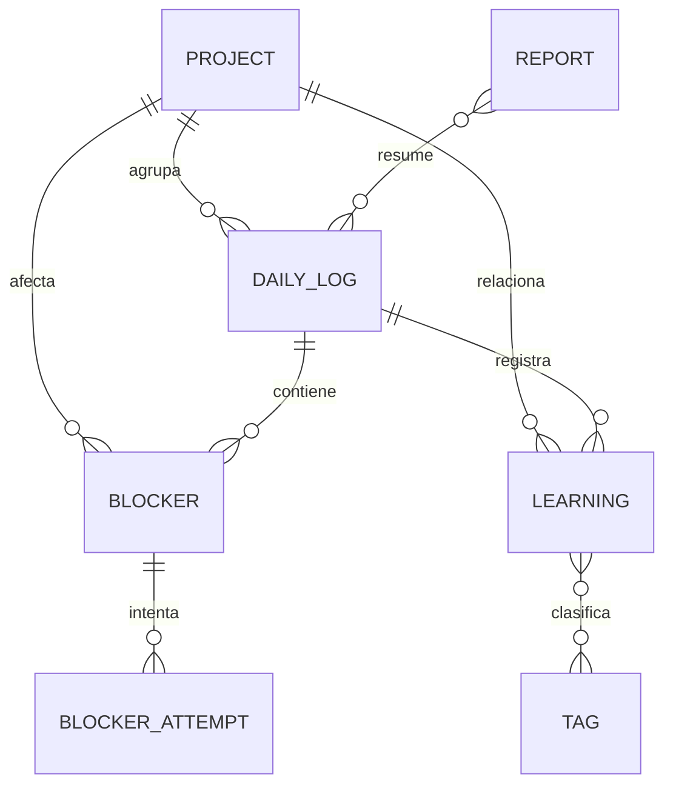

# Núcleo — Documento maestro

> Especificación de referencia del proyecto. Las decisiones de arquitectura y funcionalidad se toman aquí antes de implementarse.
> Estado: **MVP v0.1 completo; Fases 1–6 terminadas** · Siguiente: Fase 7 (instaladores, README con capturas y publicación) · Última actualización: 2026-11-01

## 1. Concepto

**Núcleo** es una aplicación de escritorio nativa para desarrolladores de software y estudiantes. Sirve para registrar, organizar y analizar la jornada: avances, tareas, bloqueos técnicos, aprendizajes y proyectos, y para generar reportes diarios y semanales.

Filosofía **Local First**: los datos se guardan en el dispositivo, la app funciona sin Internet y el usuario mantiene el control de su información.

**Objetivo principal:** facilitar el seguimiento de actividades durante las prácticas profesionales y el trabajo cotidiano como desarrollador.

## 2. Objetivos

- Una herramienta de uso real durante las prácticas.
- Mejor organización y documentación del trabajo.
- Registro de problemas técnicos y sus soluciones.
- Historial de lo aprendido.
- Generación automática de reportes.
- Privacidad y funcionamiento offline.
- Un proyecto sólido para el portafolio de GitHub.

## 3. Stack tecnológico

| Capa | Tecnología | Uso |
| --- | --- | --- |
| Escritorio | Tauri 2 | Ventana nativa, empaquetado, permisos |
| Interfaz | React 19 + TypeScript | Componentes y lógica de presentación |
| Estilos | Tailwind CSS 4 | Sistema de diseño basado en tokens |
| Nativo | Rust | Integración con el sistema operativo |
| Datos | SQLite (`tauri-plugin-sql`) | Base de datos local con migraciones |
| Estado / validación | Zustand + Zod | Estado de UI y validación de entidades |
| Pruebas | Vitest + Testing Library | Pruebas unitarias y de componentes |

No hay backend remoto. Tauri gestiona las operaciones nativas y SQLite almacena la información.

## 4. Diseño e identidad visual

Estética limpia inspirada en iOS/macOS: minimalista, con mucho espacio en blanco y una jerarquía visual clara.

| Token | Claro | Oscuro |
| --- | --- | --- |
| Fondo (`canvas`) | `#F5F5F7` | `#111113` |
| Superficie (`surface`) | `#FFFFFF` | `#1C1C1E` |
| Texto principal (`ink`) | `#1D1D1F` | `#F5F5F7` |
| Texto secundario (`ink-muted`) | `#86868B` | `#98989D` |
| Acento (`accent`) | `#007AFF` | `#0A84FF` |
| Éxito (`success`) | `#34C759` | `#30D158` |
| Advertencia (`warning`) | `#FF9F0A` | `#FF9F0A` |
| Error (`danger`) | `#FF3B30` | `#FF453A` |

- Esquinas: 12–16 px (`rounded-xl`, `rounded-2xl`).
- Tipografía: Inter (incluida en la app, sin cargar fuentes externas), con SF Pro / Segoe UI de respaldo.
- Iconografía: Lucide, trazo 1.75.
- Los tokens viven en `src/index.css` y se usan como clases de Tailwind (`bg-surface`, `text-ink-muted`, …).

**Principios:** sidebar fija y compacta, tarjetas con bordes suaves, sombras discretas, iconos lineales, animaciones naturales, formularios simples, diseño adaptable. Nada de paneles, colores o indicadores en exceso.

## 5. Módulos

| # | Módulo | Ruta | Fase | Funcionalidades |
| --- | --- | --- | --- | --- |
| 01 | Resumen (Overview) | `/` | 2 | Resumen de la jornada, actividad reciente, bloqueos pendientes, estadísticas semanales, accesos rápidos |
| 02 | Registro diario (Daily Log) | `/daily-log` | 3 | Check-in de cuatro preguntas (ayer, hoy, bloqueos, aprendizajes); historial, edición y consulta |
| 03 | Bloqueos (Blocker Tracker) | `/blockers` | 3 | Problemas técnicos asociados a proyectos, intentos de solución, tiempo abierto, estados pendiente/resuelto/escalado |
| 04 | Aprendizajes (Learning Journal) | `/learning` | 3 | Conocimientos, errores solucionados, comandos, conceptos; etiquetas y tecnologías |
| 05 | Proyectos (Projects) | `/projects` | 3 | Crear proyectos, asociar registros, avances, problemas e historial por proyecto |
| 06 | Reportes (Reports) | `/reports` | 4 | Reportes diarios y semanales, resumen de actividades y bloqueos; exportación PDF, CSV y Markdown |
| 07 | Captura rápida (Quick Capture) | `/quick-capture` | 5 | Ventana flotante, atajo global, registro rápido, clasificación posterior |
| 08 | Ajustes (Settings) | `/settings` | 5 | Apariencia, notificaciones, respaldos, exportación/importación, privacidad |

El registro de módulos (`src/modules/registry.ts`) es la fuente única para la navegación y las rutas.

## 6. Inteligencia artificial

La IA es complementaria, nunca un requisito.

| Modalidad | Funcionamiento |
| --- | --- |
| Local (predeterminada) | Plantillas y reglas para generar reportes sin Internet |
| IA opcional | Ollama en el propio equipo redacta el resumen del reporte. Rust se conecta solo a 127.0.0.1:11434 (dirección fija), así que los registros nunca salen del equipo. Se activa en Ajustes y el reporte guardado queda marcado como `local_ai`. |

La columna `reports.generator` (`template` | `local_ai`) registra cómo se generó cada reporte.

## 7. Privacidad y funcionamiento offline

- Base de datos SQLite local, en el directorio de datos de Núcleo. Se conserva el identificador de datos heredado para mantener el acceso a las bases de instalaciones anteriores.
- Sin cuenta, sin servidor remoto, sin telemetría, sin envío automático de información.
- Exportación/importación y copias de seguridad locales.
- Validación de entradas con Zod y restricciones `CHECK` en la base de datos.
- Permisos nativos mínimos (`src-tauri/capabilities/default.json`) y CSP restrictiva sin orígenes externos.
- La interfaz no tiene acceso general al disco: para exportar llama al comando Rust `export_file`, que solo escribe en la ruta que el usuario elige en el diálogo nativo de guardado.
- Exportaciones cifradas opcionales: AES-256-GCM con clave derivada por PBKDF2-SHA-256 (600 000 iteraciones), solo con Web Crypto. La contraseña no se guarda.
- Importación de exportaciones (cifradas o no) con validación estricta: solo columnas conocidas por tabla, y un respaldo automático antes de reemplazar los datos.

La app debe abrirse, registrar, consultar el historial y generar reportes sin conexión.

## 8. Modelo de datos

Implementado en [`src/database/migrations/0001_initial_schema.sql`](../src/database/migrations/0001_initial_schema.sql). Detalle en [base-de-datos.md](base-de-datos.md).



## 9. Estructura del repositorio

```text
nucleo/
├── src/
│   ├── assets/
│   ├── components/
│   │   ├── ui/            # Primitivas: Card, Button, Badge, StatCard, EmptyState
│   │   ├── layout/        # AppShell, Sidebar, PageHeader
│   │   └── shared/        # Componentes compuestos reutilizables
│   ├── modules/           # Un directorio por módulo + registry.ts
│   ├── database/
│   │   ├── migrations/    # SQL versionado (fuente única, también para Rust)
│   │   └── repositories/  # Acceso a datos por entidad
│   ├── services/          # Lógica de negocio (reportes, exportación…)
│   ├── stores/            # Estado global con Zustand
│   ├── hooks/
│   ├── types/             # Esquemas Zod y tipos de entidades
│   └── utils/
├── src-tauri/             # Proyecto Rust: plugins, migraciones, permisos
├── tests/
└── docs/
```

## 10. Roadmap

1. **Foundation** — Tauri 2, React + TS, Tailwind, SQLite, estructura, primera ventana. *(hecho)*
2. **UI Design** — sistema de diseño, sidebar, dashboard, check-in, componentes, navegación. *(hecho)*
3. **Core Features** — CRUD de registros, historial, proyectos, bloqueos, aprendizajes. *(hecho)*
4. **Reports** — reportes diarios/semanales, estadísticas, exportación, plantillas locales. *(hecho: Markdown, JSON, CSV y PDF mediante el diálogo de impresión; estadísticas en Reportes y en el Resumen)*
5. **Native Features** — captura rápida, atajos globales, notificaciones, respaldos automáticos. *(hecho: ventana flotante con Ctrl+Shift+Espacio y bandeja para clasificar, recordatorio del check-in, respaldos diarios con rotación y pantalla de Ajustes; pendiente: importar datos)*
6. **Advanced** — IA local opcional, cifrado, modo oscuro completo, pruebas, optimización. *(hecho: resumen con Ollama local, exportación cifrada e importación, modo oscuro, 141 pruebas, carga diferida de módulos: paquete inicial de 494 KB a 308 KB)*
7. **Release** — instaladores, documentación, README, capturas, publicación en GitHub.

## 11. MVP — v0.1

- [x] Aplicación de escritorio funcional con Tauri
- [x] Interfaz clean inspirada en iOS
- [x] Dashboard principal
- [x] Crear registros diarios
- [x] Editar y eliminar registros
- [x] Consultar historial *(con búsqueda)*
- [x] Almacenamiento SQLite local
- [x] Registro de bloqueos *(con intentos de solución, estados y enlace al registro diario)*
- [x] Generación de reportes mediante plantillas *(diarios y semanales, editables y guardables)*
- [x] Exportación a Markdown y JSON *(reportes y copia completa de los datos)*

## 12. Resultado esperado

Una app de escritorio instalable, minimalista, totalmente offline en sus funciones principales, con base de datos local, gestión de actividades, proyectos, bloqueos y aprendizajes, generación de reportes, herramientas nativas, pruebas, documentación técnica y un repositorio público presentable.

## 13. Decisiones tomadas

| Decisión | Resultado |
| --- | --- |
| Sistema operativo principal | **Windows** (instaladores NSIS y MSI) |
| Temas visuales | **Claro predeterminado**, oscuro opcional |
| Nombre del producto | **Núcleo** (identificador técnico de instalación conservado para actualizar instalaciones existentes) |
| Idioma de la interfaz | Español |
| Navegación | `HashRouter` (archivos estáticos dentro de Tauri) |
| Migraciones | SQL en `src/database/migrations`, incluidas desde Rust con `include_str!` |
| Fechas | `TEXT` ISO 8601: `YYYY-MM-DD` para días, UTC para marcas de tiempo |
